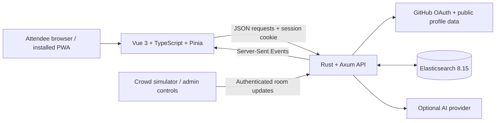

# VECTOR

**Your day. Your people. Your pace.**

A mobile-first conference companion that brings your recommended sessions, venue map, quieter spaces, and hallway connections into one place. Built around KubeCon + CloudNativeCon North America 2026 in Salt Lake City.

[Open the demo](https://vector.winslow.plus) · [Development guide](docs/LOCAL_DEVELOPMENT.md) · [GitHub OAuth setup](docs/GITHUB_OAUTH_SETUP.md) · [CI workflow](.github/workflows/ci.yml)

## Why VECTOR exists

A conference day involves more than choosing talks. Sessions overlap, rooms fill up, unfamiliar buildings take time to navigate, and good hallway conversations are easy to lose track of. For attendees managing sensory overload, finding a quiet place can matter as much as finding the next session.

VECTOR connects those decisions: start with a day shaped around your interests, see where a session is on the map, find an alternative when a room fills, take a quiet break, and keep the context of the people you meet.

## What you can do

| Feature | Experience |
| --- | --- |
| **Sign in with GitHub** | Build a technical-interest profile from your public profile, repository languages, topics, and README excerpts. |
| **Plan your day** | Browse a compact calendar of recommended sessions, inspect match reasons, and bookmark talks. Times display in Mountain Time. |
| **Explore the venue** | Use a three-floor SVG Salt Palace schematic with room selection, cross-floor search, pan, zoom, and occupancy details. Selecting a calendar session focuses its room; looking up another room preserves your calendar selection. |
| **React to crowding** | Receive room updates over Server-Sent Events. An administrator can simulate a full room and show an alternative session in both the calendar and map. |
| **Find breathing room** | Discover unscheduled rooms below 45 dB and 20% occupancy. Quiet mode adds a decompression break to the demo schedule. |
| **Meet people with shared interests** | See attendee matches based on technical interests and shared room or crowd-surge context. |
| **Keep the conversation going** | Share a QR badge, save a hallway connection, and review contextual LinkedIn and email drafts. Copy a draft or open it in your email client. |
| **Install the app shell** | Load the interface and self-hosted fonts offline after an online visit. Attendee APIs and live features require connectivity. |

The interface includes keyboard-operable room controls, labeled actions, focus restoration when room search closes, reduced-motion support, and large mobile touch targets. Room data carries wheelchair-access and captioning metadata.

## Try the flow

1. Open the demo and sign in with GitHub.
2. Select a session under **Your recommended day**, inspect its details, and choose **View on map**.
3. Switch floors or open **Find your room**. Use **Quiet spaces** to find somewhere to recharge.
4. Toggle **Quiet**, explore the suggested haven, and view your technical-interest profile under **You**.
5. Open your QR badge or select a suggested attendee. Create a connection, then open **Saved connections** to review the follow-up drafts.
6. For accounts listed in `VECTOR_ADMIN_USERS`, use the desktop control panel or mobile **Demo controls** to trigger and reset a crowd surge.

The demo contains **49 sessions, 24 tracked rooms, and 36 seeded profiles**, plus real users who sign in. The 24 supplemental fictional attendees are labeled **Demo**. Session data, room occupancy, noise readings, and attendee locations are illustrative; they are not an official conference feed or live venue sensor data. The map is an architectural schematic with approximate room placements. See [seed data and provenance](seed/README.md).

## How it works



**Frontend.** Vue 3, TypeScript, Pinia, Vite, and Tailwind CSS power the responsive PWA. Venue geometry is maintained as typed SVG data. A shared store keeps calendar selection, map details, room readings, and crowd-surge alternatives in sync, including when live events arrive during a state refresh.

**Backend.** One Rust/Axum service serves the built frontend, JSON API, and SSE stream. Tokio handles asynchronous work; Elasticsearch stores sessions, profiles, room state, and saved connections.

**Recommendations.** Session retrieval combines BM25 keyword queries with k-nearest-neighbor search over 1,536-dimensional vectors. The API returns match explanations and the actual Elasticsearch query for inspection in the desktop proof panel. The schedule builder groups sessions by start time, prioritizes bookmarks, and selects a primary and backup recommendation for each slot.

**Interest profiles and follow-ups.** An optional provider configured through `OPENAI_*` settings extracts interests, generates profile embeddings, and drafts follow-ups. Missing credentials or failed provider calls fall back to heuristic interest extraction, deterministic vectors, and template drafts. GitHub identity verification still requires real OAuth.

**Room updates.** Administrator check-ins apply atomic occupancy changes in Elasticsearch and propagate readings to the active talk. SSE updates refresh the interface. The crowd-surge demo fills Ballroom B, requests an alternative, and finds peers displaced from the same session.

### Data model

| Elasticsearch index | Stores |
| --- | --- |
| `conference_talks` | Session content, tags, times, room metadata, capacity, and vectors. |
| `builders` | GitHub-derived profiles, interests, sensory preferences, bookmarks, room context, and vectors. |
| `rooms_state` | Occupancy, capacity, noise, active session, and accessibility metadata. |
| `handshakes` | Saved meeting context and follow-up drafts, retrieved for the initiating attendee. |

Startup creates missing indices, seeds empty base indices, and backfills supplemental fixtures with bulk **create** operations. Existing supplemental records are retained, including local edits. Seed fixtures are in [`seed/`](seed/README.md).

## Run locally

### Prerequisites

- A current stable Rust toolchain with Cargo.
- Node.js 22 and npm, matching the container build and CI.
- Docker with Docker Compose for Elasticsearch 8.15.0.
- A GitHub OAuth App for local sign-in.

Elasticsearch uses a 1 GiB Java heap in the supplied Compose configuration. Leave memory available for the rest of the service and builds; Cargo is configured to use one build job.

### 1. Configure the environment

From the repository root:

```sh
cp .env.example .env
openssl rand -hex 32
```

Put the generated value in `SESSION_SECRET` inside `.env`. For the local setup below, set:

```dotenv
PUBLIC_BASE_URL=http://127.0.0.1:8080
SESSION_SECRET=<paste-your-generated-secret>
GITHUB_CLIENT_ID=<your-local-oauth-app-client-id>
GITHUB_CLIENT_SECRET=<your-local-oauth-app-client-secret>
VECTOR_ADMIN_USERS=<your-github-handle>
OPENAI_API_KEY=
```

Register the local OAuth App with homepage `http://127.0.0.1:8080` and callback `http://127.0.0.1:8080/api/auth/github/callback`. Use the same host throughout sign-in. The supplied `.env.example` points at the public deployment, so change `PUBLIC_BASE_URL` for local development. See the [OAuth guide](docs/GITHUB_OAUTH_SETUP.md) for the full flow and troubleshooting.

### 2. Start Elasticsearch

```sh
docker compose up -d elasticsearch
docker compose ps
```

Wait until Elasticsearch is healthy before starting the API. Its data persists in the Compose volume.

### 3. Build and start VECTOR

```sh
npm ci --prefix frontend-pwa
npm run build --prefix frontend-pwa
CARGO_BUILD_JOBS=1 cargo run -p backend-api
```

Open `http://127.0.0.1:8080`. The server loads `.env` from its working directory and initializes the demo data before accepting requests. Sign in with GitHub to access attendee features.

To check server reachability and OAuth configuration:

```sh
curl --fail http://127.0.0.1:8080/api/health
curl --fail http://127.0.0.1:8080/api/auth/status
```

The health endpoint reports API reachability; it does not perform a database readiness check. `oauth_configured` reports that required settings are present, rather than validating credentials with GitHub.

### Frontend development

Run `npm run dev --prefix frontend-pwa` alongside the API for hot reload. Vite proxies `/api` to port 8080. For this mode, use `PUBLIC_BASE_URL=http://127.0.0.1:5173` and register a local OAuth callback at `http://127.0.0.1:5173/api/auth/github/callback`, then restart the API. Browser mutations must match the configured public origin.

### Configuration reference

| Variable | Purpose / default |
| --- | --- |
| `PORT` | API listen port; `8080`. |
| `PUBLIC_BASE_URL` | Browser origin and OAuth callback base; defaults to `http://127.0.0.1:<PORT>` when unset. |
| `SESSION_SECRET` | Private session-signing key; at least 32 bytes required for authentication. |
| `GITHUB_CLIENT_ID`, `GITHUB_CLIENT_SECRET` | OAuth App credentials, required for sign-in. |
| `VECTOR_ADMIN_USERS` | Comma-separated GitHub handles allowed to run demo mutations; empty by default. |
| `ELASTICSEARCH_URL` | Elasticsearch endpoint; `http://127.0.0.1:9200`. |
| `OPENAI_BASE_URL` | Optional AI API base; defaults to `https://openrouter.ai/api/v1`. |
| `OPENAI_API_KEY` | Optional provider key; leave empty to use fallbacks. |
| `OPENAI_MODEL`, `OPENAI_EMBEDDING_MODEL` | Provider-compatible chat and embedding model IDs. The example environment supplies sample values; embeddings must have 1,536 dimensions. |
| `DASH0_OTLP_ENDPOINT`, `DASH0_AUTH_TOKEN` | Optional OTLP trace export settings; both required to enable the exporter. |
| `DASH0_DATASET` | Export dataset header; `default`. |
| `RUST_LOG` | Log filter; `info,backend_api=debug`. |
| `STATIC_DIR` | Built frontend location; resolves to `frontend-pwa/dist` from the repository root. |

Existing process environment variables take precedence over `.env`. Restart the API after changing its configuration. Keep credentials server-side; `.env` is ignored by Git and excluded from the Docker build context.

## Authentication and privacy

- GitHub sign-in uses the authorization-code flow with state verification and PKCE, requesting `read:user`.
- Sessions use HMAC-SHA256 signed, HttpOnly, SameSite=Lax cookies, with Secure enabled for HTTPS deployments. Sessions last seven days.
- GitHub access tokens are used during sign-in and are not saved in browser storage or the session cookie.
- Attendee APIs require a session. Surge, reset, room check-in, and audit routes additionally require an administrator account.
- Profile refresh is limited to the signed-in account. Saved-connection retrieval and handshake SSE events are scoped to their initiating attendee.
- The frontend clears private state on sign-out or session expiry. The service worker caches the public app shell and assets, excluding API responses.

When an AI provider is enabled, profile/repository context and meeting context are sent to that configured provider for the corresponding features. Follow-up messages remain drafts for the attendee to review and send.

## Verify the project

With dependencies installed, run these from the repository root:

```sh
cargo fmt --all -- --check
CARGO_BUILD_JOBS=1 cargo clippy --workspace --all-targets -- -D warnings
CARGO_BUILD_JOBS=1 cargo test --workspace
npm run build --prefix frontend-pwa
npm test --prefix frontend-pwa -- --maxWorkers=1
```

Rust integration tests use Elasticsearch and exercise protected routes, OAuth against a local provider mock, search, room updates, surge/reset, handshakes, static serving, and seed preservation. Frontend tests cover stale-response reconciliation, session expiry, quiet-space updates, calendar/map behavior, and geometry bindings.

Playwright covers anonymous access, desktop and mobile attendee flows, keyboard dismissal, room search, QR connections, and offline-shell reload. These tests require a dedicated test API with matching test-only signing keys. Follow the [browser-test setup](docs/LOCAL_DEVELOPMENT.md) before running them. Integration and browser tests modify fixture data; use a separate development database.

The [GitHub Actions workflow](.github/workflows/ci.yml) runs formatting, Clippy, Rust tests with an Elasticsearch service, frontend tests/build, and the integrated browser flow.

## Crowd simulator

The Rust CLI exercises room arrivals, departures, search requests, and a simulated surge. It requires a signed-in administrator's cookie in `VECTOR_SESSION_COOKIE`, using the full cookie header form `vector_sid=<value>`.

With that environment variable configured privately:

```sh
cargo run -p crowd-simulator -- --target http://127.0.0.1:8080 --mode wave --concurrency 25
cargo run -p crowd-simulator -- --target http://127.0.0.1:8080 --mode surge --concurrency 25
cargo run -p crowd-simulator -- --target http://127.0.0.1:8080 --mode reset
```

Concurrency accepts 1–256 attendees. These commands change demo room state. Reset restores the Ballroom B surge scenario. Treat the session cookie as a credential.

## Deployment and observability

The multi-stage [`Dockerfile`](Dockerfile) builds the PWA and both Rust binaries, then packages them with the seed fixtures. [`docker-compose.yml`](docker-compose.yml) starts Elasticsearch only; run the API separately or build the application image with `docker build -t vector .`.

[`Caddyfile`](Caddyfile) provides the public-domain reverse proxy configuration with SSE flushing. [`k8s/`](k8s/) contains a namespace, Elasticsearch StatefulSet with persistent storage, and API Deployment/Service. These are deployment starting points: supply an application image, GitHub OAuth credentials, a signing key, the correct public origin, and any administrator settings. The supplied Elasticsearch configuration disables authentication for the demo and requires network protection in a deployment.

The API includes instrumented handlers, application logs, request IDs, and optional OTLP trace export. Metric instruments cover occupancy, noise, reroutes, query latency, token counts, and SSE clients; the current telemetry initialization does not configure a metrics exporter. Dash0 collection, dashboards, Radar investigations, and Gitar bot reviews require their own setup and evidence.

Two engineering write-ups document actual work and its limits:

- [Room-audit performance exercise](docs/SRE_INCIDENT_REPORT.md): replacing a deliberately sequential 15-request baseline with one Elasticsearch `_mget` reduced the measured local median from **173.843 ms to 16.537 ms** across seven runs. This is a local benchmark with substantial variance.
- [Sign-in timeout diagnosis](docs/SRE_SIGNIN_TIMEOUT.md): memory contention from duplicate Elasticsearch and other workloads caused profile/database timeouts; the report records the diagnosis, recovery, and HTTP verification.

## Prototype scope

VECTOR is a working conference-companion demo with these current limitations:

- The map, occupancy, noise, location, and match percentages are illustrative. They do not establish walking directions, measured proximity, or venue accessibility guarantees.
- Scheduling assumes the seeded start-time slots, with a fixed quiet-break slot. It does not optimize arbitrary overlapping session lengths or reserve seats.
- Seed vectors use deterministic hashing. Provider-generated profile vectors are not in the same embedding space; a production semantic-search rollout needs consistent embeddings across profiles and sessions. The `rrf_score` field currently represents a reciprocal of the combined result rank, rather than fusion of independently ranked lists.
- QR badges open the connection flow. The optional PIN is not enforced by the connection endpoint and does not establish mutual consent.
- Room-to-talk propagation and SSE broadcasting are coordinated within one API process. Multiple replicas do not share that lock or event channel, and updates across documents are not transactional.
- Offline support covers the public shell, assets, and fonts. Sign-in, recommendations, and saved-connection retrieval need the server.

## Repository guide

```text
backend-api/       Rust API, OAuth, models, search, scheduling, and integration tests
frontend-pwa/      Vue/TypeScript PWA, SVG map, state tests, and Playwright flows
crowd-simulator/  Authenticated Rust CLI for room and surge scenarios
seed/             Base and supplemental demo fixtures with provenance notes
docs/             Local setup, OAuth, UX plans, and engineering reports
k8s/              Kubernetes deployment templates
.github/          CI workflow
.gitar/           Project-specific code-review conventions
```

Start with [local development](docs/LOCAL_DEVELOPMENT.md), [OAuth configuration](docs/GITHUB_OAUTH_SETUP.md), and [seed data](seed/README.md). The [attendee UX plan](docs/ATTENDEE_UX_PLAN.md) and [map/auth plan](docs/MAP_AND_AUTH_PLAN.md) explain the design decisions. [`IMPLEMENTATION.md`](IMPLEMENTATION.md) and [`CODEX_HANDOVER.md`](CODEX_HANDOVER.md) preserve development history; some descriptions there reflect earlier plans or intermediate states.
